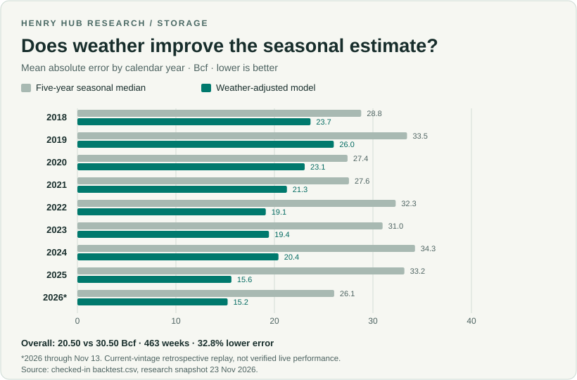

# Henry Hub Research Lab

**John Barreto · Independent U.S. natural gas research**

I study how weather, storage and delivery dates affect what a natural gas price tells us. This repository contains five browser tools, their source data and methods, and a dated storage forecast ledger. The repository URL carries the name of the original futures explorer. The full lab opens at **[/lab/](https://neurax-jb.github.io/Henry-Hub-Futures-Curve-Explorer-How-the-Natural-Gas-Market-prices-winter/lab/)**.

## Start with the storage study

How much does observed weather improve a seasonal estimate of the weekly change in Lower 48 working gas? From **5 January 2018 through 13 November 2026**, the weather-adjusted model missed by **20.50 billion cubic feet (Bcf)** on average. The five-year seasonal median missed by **30.50 Bcf** on the same 463 weeks. That is about **10 Bcf less error per week**, a 32.8% reduction in mean absolute error.

The model uses observed, population-weighted U.S. heating and cooling degree days and trains on earlier weeks. Its historical inputs may include revisions, and their original publication times have not all been established. The 23 November 2026 research snapshot had **zero completed live forecasts scored**. The dated ledger tracks forecasts issued for subsequent evaluation.

[Read the study](lab/research/storage-weather.md) · [Inspect the 463 replay rows](https://github.com/NeuraX-JB/Henry-Hub-Futures-Curve-Explorer-How-the-Natural-Gas-Market-prices-winter/blob/ba3b94ba3a97c3262099da73a25a3a33f06c34ee/lab/storage/backtest.csv) · [Verify the published metrics](https://github.com/NeuraX-JB/Henry-Hub-Futures-Curve-Explorer-How-the-Natural-Gas-Market-prices-winter/blob/ba3b94ba3a97c3262099da73a25a3a33f06c34ee/lab/storage/state.json) · [Track dated forecasts](lab/storage/ledger/)



## Explore the five tools

Each tool runs within this lab. The project repositories alongside them provide standalone editions with documented snapshots and their own validation instructions.

| Research task | Use the lab tool | Inspect the project |
| --- | --- | --- |
| Estimate the coming EIA storage change and compare its weather adjustment with the seasonal median. | [Storage forecaster](https://neurax-jb.github.io/Henry-Hub-Futures-Curve-Explorer-How-the-Natural-Gas-Market-prices-winter/lab/storage/) | [Storage project](https://github.com/NeuraX-JB/henry-hub-storage-forecaster) · [Lab model](lab/storage/model.py) |
| Compare two GFS forecast runs over their common valid dates and inspect a state's heating or cooling revision. | [Weather revision monitor](https://neurax-jb.github.io/Henry-Hub-Futures-Curve-Explorer-How-the-Natural-Gas-Market-prices-winter/lab/weather/) | [Weather project](https://github.com/NeuraX-JB/natural-gas-weather-monitor) · [Lab method](lab/weather/README.md) |
| Follow the same delivery month across observation dates, or inspect the March–April spread. | [Original curve explorer](https://neurax-jb.github.io/Henry-Hub-Futures-Curve-Explorer-How-the-Natural-Gas-Market-prices-winter/) | [Standalone curve project](https://github.com/NeuraX-JB/henry-hub-futures-curve) · [Original application](index.html) |
| Compare fixed-share and variable fuel budgets for a U.S. plant across a historical winter. | [Industrial gas cost simulator](https://neurax-jb.github.io/Henry-Hub-Futures-Curve-Explorer-How-the-Natural-Gas-Market-prices-winter/lab/industrial/) | [Industrial project](https://github.com/NeuraX-JB/industrial-gas-cost-simulator) · [Lab calculations](lab/industrial/model.js) |
| Join storage, observed weather and Henry Hub spot prices on a common weekly index. | [Data API explorer](https://neurax-jb.github.io/Henry-Hub-Futures-Curve-Explorer-How-the-Natural-Gas-Market-prices-winter/lab/api/) | [API project](https://github.com/NeuraX-JB/natural-gas-data-api) · [Lab API guide](lab/api/README.md) · [Notebook](lab/api/natural_gas_api.ipynb) |

## Read the second study

In the June and September 2026 fund holdings, January 2027 delivery fell from $4.391 to $3.752 per million Btu. The published note shows how to match identical delivery months. The longer curves come from SEC fund filings, published after the position dates. The separate EIA archive covers the four nearby contracts.

[Read the delivery-month study](lab/research/curve-repricing.md) · [Compare the two curves](https://neurax-jb.github.io/Henry-Hub-Futures-Curve-Explorer-How-the-Natural-Gas-Market-prices-winter/?data=strips&view=curve&a=2026-06-30&b=2026-09-30&align=delivery) · [Browse both publications](https://neurax-jb.github.io/Henry-Hub-Futures-Curve-Explorer-How-the-Natural-Gas-Market-prices-winter/lab/research/) · [Research notes repository](https://github.com/NeuraX-JB/natural-gas-research-notes)

## Check the data

Coverage from the **24 November 2026** manifest appears below. Each series ends on a different date. The API aligns weather and cash prices with storage reference weeks and preserves missing values.

| Series | What is measured | Coverage in this snapshot | Records |
| --- | --- | --- | ---: |
| EIA working gas | Lower 48 inventories on Fridays (Bcf). Weekly change is the difference between consecutive Friday stocks. | 1 Jan 2010–13 Nov 2026 | 881 |
| NOAA observed weather | Contiguous U.S. population-weighted heating and cooling degree days, base 65°F, summed Friday through Thursday. | 9 Jan 1981–20 Nov 2026 | 2,394 |
| EIA Henry Hub spot | Published daily cash quotes in USD/MMBtu. The weekly average uses the available quote days. | 7 Jan 1997–17 Nov 2026 | 5,732 |

[Manifest behind this table](https://github.com/NeuraX-JB/Henry-Hub-Futures-Curve-Explorer-How-the-Natural-Gas-Market-prices-winter/blob/0b1aaa751bd48274a11e72aaee8f4e44391796d2/lab/data/manifest.json) · [Latest data status](https://neurax-jb.github.io/Henry-Hub-Futures-Curve-Explorer-How-the-Natural-Gas-Market-prices-winter/lab/api/status.html) · [Data dictionary](lab/data/README.md) · [API field definitions](lab/api/v1/index.json)

The lab's scheduled [refresh workflow](.github/workflows/refresh.yml) rebuilds the EIA and NOAA data, checks the outputs and publishes the dated forecast records. The weather monitor separately compares archived GFS forecasts. Source links, attribution and third-party reuse terms are collected in [Data sources](DATA_SOURCES.md). The repository declares no general open-source license.

## Run the lab locally

From the repository root, serve the checked-in data and pages with Python 3.

```sh
python -m http.server 8000
```

Open `http://localhost:8000/lab/` for the full lab or `http://localhost:8000/` for the original curve explorer. The [technical guide](lab/README.md) covers rebuilding the data with Python and NumPy and running the Python and Node.js checks. Rebuilding GFS weather inputs also requires GDAL. [Weather build instructions](lab/weather/README.md)

Published for research and education. Historical model errors and illustrative procurement budgets do not establish future performance.
